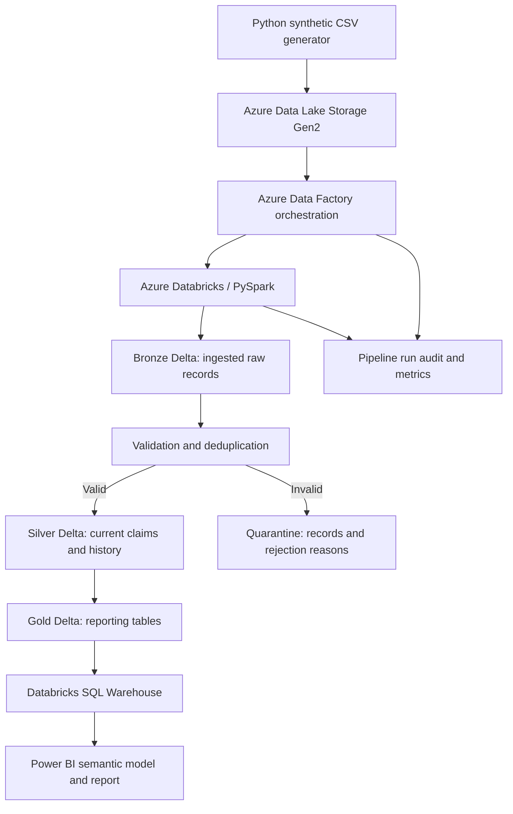

# Azure Insurance Claims Analytics Pipeline

> **Status: Planning / Step 1 — Business requirements and data design**

An end-to-end **Azure data engineering portfolio project** that ingests synthetic insurance claims, validates and transforms them with PySpark, maintains trusted Delta Lake tables, and prepares reporting datasets for Power BI.

**All insurance data in this repository will be synthetic.** This is a learning and portfolio project, not a production insurance system.

## Business problem

A fictional Canadian insurer, **Northstar Insurance**, receives monthly claims files from regional offices. Data quality issues, duplicate records, and claims that change status over time make consistent reporting difficult. This project aims to automate ingestion and validation, preserve traceability, and provide reliable reporting on claims volumes, decisions, and approved amounts.

## Project objectives

- Build an end-to-end Azure ETL pipeline using PySpark and Delta Lake.
- Implement automated data validation, deduplication, and incremental updates.
- Design a bronze, silver, and gold lakehouse architecture.
- Orchestrate data processing with Azure Data Factory.
- Develop a Power BI dashboard using trusted reporting tables.
- Measure pipeline reliability, data quality, performance, and cloud costs.

## Planned architecture

Original source CSV files will be retained unchanged in ADLS Gen2. Bronze Delta tables will capture their ingested contents and metadata.

## Planned technology stack

| Layer | Technology | Purpose |
|---|---|---|
| Data generation | Python | Create synthetic monthly claims and controlled test cases |
| Storage | Azure Data Lake Storage Gen2 | Retain raw files and processed data |
| Orchestration | Azure Data Factory | Trigger and monitor pipeline runs |
| Processing | Azure Databricks, PySpark | Validate, deduplicate, and transform claims |
| Lakehouse | Delta Lake | Maintain bronze, silver, and gold tables |
| Reporting access | Databricks SQL | Query gold reporting tables |
| Visualization | Power BI | Build claims performance dashboard |
| Quality and testing | Python tests, PySpark checks | Verify expected data and pipeline behavior |

## Planned dataset

The initial target is **approximately 100,000 unique fictional claims** across 12 monthly files for January–December 2026. Additional rows will represent claim updates, duplicates, and intentionally invalid test cases.

| Field | Type | Meaning |
|---|---|---|
| `claim_id` | STRING | Unique business identifier for a claim |
| `policy_id` | STRING | Fictional insurance policy identifier |
| `claim_type` | STRING | Auto, Home, Health, or Travel |
| `region` | STRING | Canadian reporting region |
| `date_submitted` | DATE | Submission date |
| `date_closed` | DATE, nullable | Resolution date for closed claims |
| `status` | STRING | OPEN, APPROVED, or DENIED |
| `claimed_amount` | DECIMAL(12,2) | Requested amount in CAD |
| `approved_amount` | DECIMAL(12,2) | Authorized amount in CAD |
| `last_updated_at` | TIMESTAMP | Timestamp of latest source update |

Ingestion metadata will include `source_file`, `ingested_at`, and `batch_id`.

## Data quality and update rules

Planned validation includes:

- Reject records with missing required identifiers, unsupported statuses, malformed dates, or negative claim amounts.
- Reject claims where approved amounts exceed claimed amounts, or closure dates precede submission dates.
- Require closure dates for APPROVED and DENIED claims; OPEN claims must have no closure date.
- Require zero approved amount for OPEN and DENIED claims, and a positive amount for APPROVED claims.
- Quarantine rejected records with explicit error reasons.
- Treat newer versions of a claim as updates, not new claims; ignore exact duplicates and stale updates.
- Quarantine conflicting versions with the same claim ID and update timestamp.
- Make batch reprocessing idempotent so reruns do not duplicate business records.

These are **project-specific synthetic business rules**, not general insurance-industry rules.

## Planned dashboard KPIs

- Claims submitted by submission month
- Current OPEN, APPROVED, and DENIED claim counts
- Total and average approved amounts (CAD)
- Average days to close, for closed claims
- Approval and denial rates among resolved claims
- Breakdown by claim type and region
- Latest successful data refresh and pipeline run status, if practical

Approval rate = approved claims / (approved claims + denied claims). Historical monthly submissions and current status counts are different measures and will be labelled accordingly.

## Project roadmap

- [x] Define initial business requirements, data dictionary, rules, and KPIs
- [ ] Generate synthetic monthly claims and expected-results manifest
- [ ] Create and configure Azure resources
- [ ] Upload original CSV files to ADLS Gen2
- [ ] Implement bronze ingestion, silver validation, quarantine, and updates
- [ ] Create gold reporting tables
- [ ] Orchestrate processing with Azure Data Factory
- [ ] Connect and build the Power BI report
- [ ] Run controlled reliability, quality, and performance tests
- [ ] Document actual results, costs, screenshots, and lessons learned

## Acceptance criteria (targets, not measured results)

| Area | Target |
|---|---|
| Ingestion | Process 12 monthly source batches |
| Quality | Detect all intentionally injected invalid records in controlled tests |
| Deduplication | No duplicate claim IDs in the current silver claims table |
| Idempotency | Reprocessing a batch does not change business results |
| Updates | Newer claim versions correctly replace current versions |
| Auditability | Every rejected record has a reason and source reference |
| Reporting | Gold KPIs reconcile with independent expected results |
| Reliability | Normal, malformed, stale-update, and rerun tests behave as expected |
| Performance | Measure elapsed time and throughput on repeatable workloads |
| Freshness | Measure file-arrival-to-report-refresh time; initial test target ≤60 minutes |
| Cost | Track actual Azure spending and stay within a pre-set budget |

**No pipeline benchmarks or savings are claimed yet.** Results will be added only after implementation and testing.
