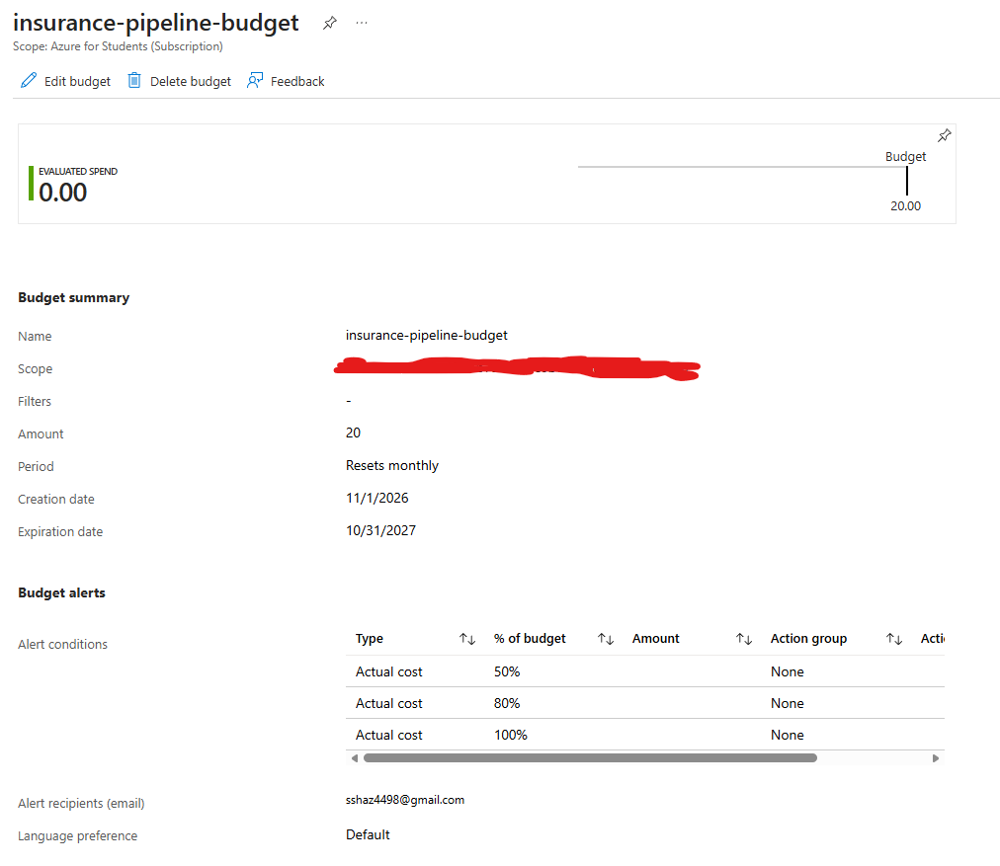

# Azure Infrastructure Setup

This document tracks the Azure services, configurations, technical decisions, and lessons learned while building the Insurance Claims Analytics Pipeline.

## 1. Subscription and Cost Management

Before deploying any cloud resources, I configured Azure Cost Management to monitor spending and reduce the risk of unexpected charges.

### Configuration

| Setting | Value |
|---|---|
| Subscription | Azure for Students |
| Initial credits | $100 USD |
| Budget name | `insurance-pipeline-budget` |
| Monthly budget | $20 |
| Alert thresholds | 50%, 80%, 100% |
| Alert type | Actual cost |
| Budget reset | Monthly |

### Implementation

1. Verified that my Azure for Students subscription was active.
2. Opened Azure Cost Management and created a subscription-level budget.
3. Set a monthly budget of $20.
4. Configured email notifications at 50%, 80%, and 100% of the budget.
5. Confirmed that the budget was active and initial spending was $0.00.

### Screenshot — Azure Cost Management Budget

*Figure 1: Azure Cost Management budget configured with a $20 monthly threshold and three spending alerts.*

### What I learned

- **Azure subscriptions** provide access to cloud resources and manage billing.
- **Azure Cost Management** provides tools to monitor resource spending.
- **Budgets** allow spending thresholds to be established at the subscription level.
- **Budget alerts** send notifications when spending reaches configured thresholds, but they do not automatically shut down resources.
- Establishing cost controls before deployment helps manage usage-based cloud expenses.

### Outcome

Successfully configured a monthly budget with three spending alerts before provisioning the project's Azure infrastructure.

Actual infrastructure costs and pipeline execution costs will be documented as development progresses.
